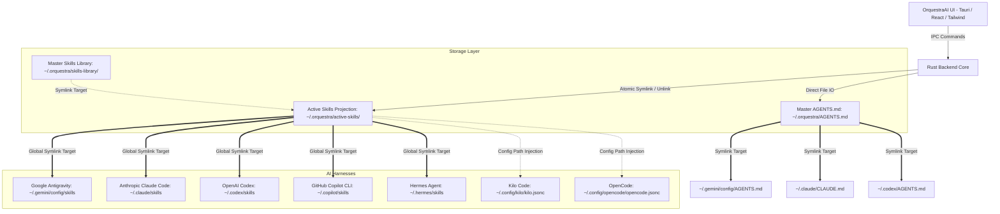

# Product Requirements Document (PRD)
## OrquestraAI — Universal AI Harness Administration Platform

- **Project Name:** OrquestraAI
- **Target OS:** Linux (x86_64 / Arch / Debian / Fedora)
- **Architecture:** Tauri v2 (Rust Native Core + Modern Webview UI)
- **Author:** Isa (Google DeepMind Antigravity) & Operator
- **Status:** Draft / Ready for Implementation

---

## 1. Executive Summary & Problem Statement

### 1.1 The Context-Bloat Problem
Modern autonomous AI harnesses (Antigravity, Claude Code, OpenAI Codex, GitHub Copilot, Hermes Agent, Kilo Code, OpenCode, Grok) discover and register skills by indexing folders containing `SKILL.md` files. Each registered skill has its name, description, parameters, and invocation criteria injected directly into the agent's **System Prompt** on startup.

When an engineer maintains a rich library of 40+ specialized skills (AWS, Reverse Engineering, UI Guidelines, Docker, etc.), every interaction across every harness begins with thousands of wasted input tokens before the user types a single word. Even if none of those skills are invoked during a session, the model suffers from:
1. **Severe Token Inefficiency:** Inflated API costs and rapid exhaustion of rate limits.
2. **Context Window Degradation:** Slower time-to-first-token (TTFT) and reduced reasoning fidelity ("needle in a haystack" degradation).
3. **Prompt Dilution:** Multi-agent confusion over conflicting skill triggers.

### 1.2 The Fragmentation Problem
Currently, the operator maintains over 10 distinct AI harnesses across CLI and GUI environments. Each has its own configuration path, session storage, and prompt rule mechanisms. Manually enabling or disabling skills across 10 directories is unsustainable.

### 1.3 The Solution: OrquestraAI
**OrquestraAI** is a high-performance, native desktop application built with **Rust and Tauri v2**. It serves as a unified control plane that:
- Centralizes all skills in a single master library.
- Provides an instant, elegant UI toggle (ON/OFF) for each skill.
- When toggled **OFF**, the skill is atomically removed from the active view, rendering every single AI harness **100% blind** to it (zero tokens consumed).
- When toggled **ON**, the skill is projected into all harnesses simultaneously via atomic symbolic links.
- Unifies global instructions (`AGENTS.md` / `CLAUDE.md`) so that editing prompts in one central UI updates every agent concurrently.
- Provides unified lifecycle tools for sessions, chats, and MCP servers in subsequent phases.

---

## 2. Core Architectural Principles



### 2.1 Single Source of Truth + Active Inode Projection
1. **Master Vault (`~/.orquestra/skills-library/`):** Permanent storage for every skill repository. Disabling a skill **never** deletes its source code or assets.
2. **Active Projection (`~/.orquestra/active-skills/`):** Contains only symbolic links pointing to enabled items in the master vault.
3. **Harness Binding:** Each harness directory is symlinked directly to `~/.orquestra/active-skills/`.
4. **Atomic Switch Operation:**
   - **Enable:** `std::os::unix::fs::symlink(vault_path, active_path)`
   - **Disable:** `std::fs::remove_file(active_path)`
   - **Cost:** Sub-millisecond filesystem operation; zero disk I/O duplication; immediate blindness for any newly spawned session or reload.

---

## 3. Comprehensive Filepath & Target Matrix

Every path below has been inspected and verified directly on the host filesystem:

| Harness / Ecosystem | Type | Skills Directory | Instructions / Rules | Sessions & History | MCP Config / Hooks |
| :--- | :--- | :--- | :--- | :--- | :--- |
| **Google Antigravity** | GUI & IDE | `~/.gemini/config/skills/`<br>`~/.gemini/skills/` | `~/.gemini/config/AGENTS.md`<br>`~/.gemini/GEMINI.md` | `~/.gemini/antigravity/brain/<id>/`<br>`conversation_summaries.db` | `~/.gemini/config/mcp_config.json`<br>`~/.gemini/config/hooks.json` |
| **Antigravity IDE** | VS Code Fork | `~/.gemini/antigravity-ide/skills` (inherits) | `~/.gemini/config/AGENTS.md` | `~/.gemini/antigravity-ide/conversations/` | `~/.config/Antigravity IDE/` |
| **OpenAI Codex** | CLI & Desktop | `~/.codex/skills/` | Project `AGENTS.md`<br>`~/.codex/config.toml` | `~/.codex/thread_history_1.sqlite`<br>`~/.codex/plans/` | `~/.codex/config.toml` (`[mcp]`)<br>`~/.codex/pets/` |
| **Anthropic Claude Code** | CLI (TUI) | `~/.claude/skills/` | `~/.claude/CLAUDE.md` | `~/.claude/history.jsonl`<br>`~/.claude/sessions/` | `~/.claude.json` (`mcpServers`)<br>`~/.claude/settings.json` (`hooks`) |
| **GitHub Copilot CLI** | CLI (TUI) | `~/.copilot/skills/` | CLI flags / Project Rules | `~/.copilot/session-store.db`<br>`~/.copilot/session-state/` | `~/.copilot/mcp-config.json`<br>`~/.copilot/hooks/` |
| **xAI Grok / Grok Bot** | CLI & GUI | `~/.grok/installed-plugins/`<br>`~/.grok/bundled/` | `~/.grok/config.toml`<br>`~/.grok/trusted_folders.toml` | `~/.grok/active_sessions.json`<br>`~/.grok/memory-v2/` | `~/.grok/config.toml` |
| **Stably Orca** | GUI & CLI | Mirrored / Project level | Project `AGENTS.md` | `~/.config/orca/orchestration.db`<br>`agent-session-journal.db` | `~/.orca/agent-hooks/`<br>`codex-hook.sh`, `opencode-hooks/` |
| **Nous Research Hermes** | CLI (TUI) | `~/.hermes/skills/` | `~/.hermes/config.yaml`<br>`~/.hermes/.env` | `~/.hermes/state.db`<br>`~/.hermes/sessions/` | `~/.hermes/plugins/`<br>`~/.hermes/sandboxes/` |
| **Kilo Code** | CLI (TUI) | Configured in `kilo.jsonc` (`skills.paths`) | `~/.config/kilo/kilo.jsonc`<br>Project `AGENTS.md` | `~/.kilo/` sessions SQLite / Cloud fork | `~/.config/kilo/kilo.jsonc` |
| **OpenCode** | CLI (TUI) | Configured in `opencode.jsonc` (`skills.paths`) | Project `AGENTS.md` | `~/.local/share/opencode/opencode.db`<br>`~/.nsstyx/terceiros/agent/opencode/` | `~/.config/opencode/opencode.jsonc`<br>Integrated REA MCP |
| **Freebuff / Manicode** | GUI & CLI | Worktree based | `~/.config/manicode/settings.json` | `~/.config/manicode/message-history.json`<br>`~/.freebuff/worktrees/` | `~/.config/freebuff/byok/connections.json` |

---

## 4. Functional Specifications

### Feature Module 1: Universal Skills Management (Phase 1 — Priority)
1. **Master Skills Parser:**
   - Scan each folder in `~/.orquestra/skills-library/*/SKILL.md`.
   - Parse YAML frontmatter:
     - `name`: Human-readable identifier.
     - `description`: Scope and usage instructions.
   - Calculate approximate token weight of the `SKILL.md` content (e.g., `character_count / 3.8`).
2. **Toggle Controller:**
   - Switch state (Active / Inactive).
   - Instant file manipulation:
     - **Toggle ON:** Creates symlink in `~/.orquestra/active-skills/<skill-name>`.
     - **Toggle OFF:** Unlinks `~/.orquestra/active-skills/<skill-name>`.
3. **Live Token Savings Counter:**
   - Header metric displaying:
     - `Active Skills: X / Total: Y`
     - `Estimated Tokens Saved per Turn: ~Z tokens` (Sum of disabled skill definitions).
4. **Preset Profiles:**
   - "Full Stack Mode" (Frontend, Backend, Docker, DB skills ON).
   - "Security & Reverse Engineering Mode" (REA, Pentest, Decompiler skills ON).
   - "Minimal / Zen Mode" (All non-essential skills OFF).
5. **Skill Ingest / Import:**
   - Drag & drop or folder picker to install a new skill directly into `skills-library/`.

### Feature Module 2: Global `AGENTS.md` Synchronizer (Phase 1 — Priority)
1. **Monaco / CodeMirror Markdown Editor:**
   - Live syntax-highlighted editor inside OrquestraAI.
2. **Atomic Write & Symlink Binding:**
   - Primary file: `~/.orquestra/AGENTS.md`.
   - Symlinked to:
     - `/home/system/.gemini/config/AGENTS.md`
     - `/home/system/.claude/CLAUDE.md`
     - `/home/system/.codex/AGENTS.md`
3. **Diff & History / Snapshots:**
   - Backup previous revisions before saving modifications.

### Feature Module 3: Session & History Cleanup (Phase 2)
1. **Harness Session Sweeper:**
   - Visual inspect and wipe buttons for SQLite databases and JSONL history:
     - Antigravity: `~/.gemini/antigravity/brain/`
     - Claude: `~/.claude/history.jsonl` and `~/.claude/sessions/`
     - Codex: `~/.codex/thread_history_1.sqlite`
     - OpenCode / Manicode: Trigger or integrate with existing `wipeagent` and `wipemanicode` routines.

### Feature Module 4: MCP Server Central Registry (Phase 3)
1. **Central MCP Schema:**
   - Unified GUI to add/remove local & remote MCP servers.
   - Automatically compile and deploy config sections to:
     - `~/.gemini/config/mcp_config.json`
     - `~/.claude.json` (`mcpServers`)
     - `~/.copilot/mcp-config.json`
     - `~/.config/opencode/opencode.jsonc`

---

## 5. Technology Stack & Implementation Details

```
[ Frontend: React 19 + TypeScript + Vite + Tailwind CSS + Lucide Icons + Shadcn UI ]
                                       ▲
                                       │ Tauri IPC Bridge (JSON-RPC)
                                       ▼
[ Backend: Tauri v2 Core (Rust) ]
   ├── fs_manager (std::os::unix::fs symlink & atomic unlink)
   ├── watcher (notify crate for inotify real-time filesystem events)
   ├── parser (gray_matter / serde_yaml for SKILL.md frontmatter extraction)
   └── config_sync (serde_json / toml-rs for config distribution)
```

### 5.1 Why Tauri v2 over Pure Rust GUI or Electron?
- **No "Potato UI":** Pure Rust GUI frameworks (`egui`, `iced`, `slint`) lack modern CSS layout paradigms, animations, and micro-interactions. With Tauri, the UI is styled with Tailwind CSS, delivering dark mode, translucent panels, and responsive grids identical to Raycast or Linear.
- **Microscopic Resource Footprint:** Memory usage of ~30MB RAM vs 600MB+ in Electron.
- **Native OS Safety:** All symlinks and file I/O operations execute with raw POSIX performance in Rust, eliminating race conditions or file locking issues.

### 5.2 Core Rust IPC Interface (`src-tauri/src/main.rs`)

```rust
#[tauri::command]
fn list_skills() -> Result<Vec<SkillItem>, String>;

#[tauri::command]
fn set_skill_state(name: String, enabled: bool) -> Result<(), String>;

#[tauri::command]
fn batch_toggle_skills(skills: Vec<(String, bool)>) -> Result<(), String>;

#[tauri::command]
fn read_master_agents_md() -> Result<String, String>;

#[tauri::command]
fn write_master_agents_md(content: String) -> Result<(), String>;

#[tauri::command]
fn check_harness_symlink_health() -> Result<HarnessHealthStatus, String>;
```

---

## 6. Implementation Roadmap

### Phase 1: Storage Initialization & One-Time Migration
1. Initialize `~/.orquestra/skills-library/` and `~/.orquestra/active-skills/`.
2. Move all existing unique skills from `~/.gemini/config/skills/`, `~/.codex/skills/`, and `~/.claude/skills/` into `skills-library/`.
3. Establish the symlink bridge from every harness directory to `~/.orquestra/active-skills/`.
4. Validate that existing harnesses load active skills without behavioral regression.

### Phase 2: Tauri v2 Scaffold & Rust Backend
1. Scaffold Tauri v2 project in `/home/system/Persistente/Coding/OrquestraAI`.
2. Implement Rust file system manager (`symlink`, `unlink`, `read_dir`, frontmatter parser).
3. Implement `inotify` watcher to keep UI in sync if files are touched via terminal.

### Phase 3: Frontend UI Design (Anti-Potato Guarantee)
1. Dark Mode first aesthetic (Zinc / Slate palette with emerald accents for active state).
2. Skill Card Grid with instant search, category tags, and toggle switches.
3. Metric Banner: Token impact scoreboard showing real-time token savings.
4. AGENTS.md tab with full Markdown editor.

### Phase 4: Verification & Multi-Harness Testing
1. Toggle skill OFF in OrquestraAI -> Verify it disappears immediately in `agy`, `codex`, `claude`, and `kilo`.
2. Toggle skill ON -> Verify it becomes callable.
3. Confirm zero broken symlinks and benchmark token load before and after.

---

## 7. Approval & Sign-off

- **Document Location:** `/home/system/Persistente/Coding/OrquestraAI/PRD.md`
- **Next Step:** Review specification, approve project scaffolding, and begin Tauri initialization upon operator signal.
